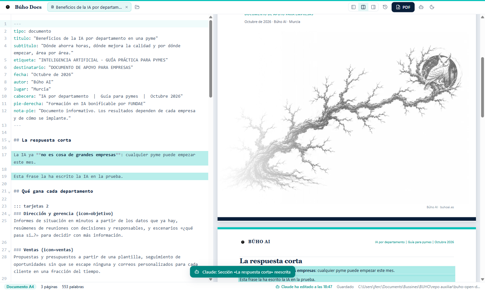

# Búho Docs · open docs, agentic first

Documentos **A4** y presentaciones **16:9** en PDF, escritos en Markdown, con el estilo Búho AI. Tú corriges erratas en un editor sencillo; la IA escribe y cambia secciones o diapositivas por comandos; **los dos veis cada cambio en directo** y todo queda en un historial firmado. De Buho Corps Systems.



## Por qué

Hacer un PDF bonito con una IA suele ser: pedirlo, esperar a que genere un script, ejecutarlo, abrir el PDF, ver la errata, volver a pedirlo… Búho Docs lo convierte en un documento vivo:

- **Markdown con cabecera YAML** como fuente: la IA lo escribe de maravilla y tú lo entiendes.
- **Vista previa = PDF**: la misma página que ves es la que imprime Chromium (A4 con paginador propio: 20 páginas en ~40 ms; diapositivas de 13,33 × 7,5 pulgadas, como los decks de PowerPoint).
- **PDF en caliente**: tras cada cambio la app prepara el PDF en segundo plano; `export` solo lo escribe (~0,1 s).
- **Cambios de la IA en directo**: el editor y la vista se actualizan solos y resaltan lo que ha cambiado, sin perder tu cursor ni tu deshacer.
- **Cambios pequeños**: la IA reescribe una sección, una diapositiva o una cifra (`section`, `slide`, `replace`, `meta`) en vez de regenerarlo todo.
- **Historial** por documento: quién cambió qué (tú, Claude, Codex, otro programa), con las diferencias y vuelta a cualquier versión.
- **Erratas en un clic**: haz doble clic en una palabra de la vista previa y el editor la selecciona; corrector ortográfico con sugerencias en el clic derecho.

## Plantilla Búho

Navy `#0A1F3A` + turquesa `#00C1B8`, Georgia en títulos, Calibri en el texto.

| Documento A4 | Presentación 16:9 |
|---|---|
|  |  |

- **Documento**: portada con logo, etiqueta, título y el árbol con el búho; cabecera y pie en cada página; tablas con cabecera navy.
- **Presentación**: diseños `portada`, `normal`, `seccion`, `cita`, `cierre`, `dos-columnas`, `cifras`, `imagen`; aviso en rojo si una diapositiva no cabe.
- **Bloques** para los dos: `::: caja`, `::: tarjetas` (con iconos), `::: cifras`, `::: pasos`, `::: columnas`, `::: panel`, `::: nota`, `::: cita`. Iconos de [Lucide](https://lucide.dev) con alias en español (`{icon=cohete}`).

Ejemplos: [`examples/beneficios-ia-pymes.md`](examples/beneficios-ia-pymes.md) (documento) y [`examples/beneficios-ia-pymes-slides.md`](examples/beneficios-ia-pymes-slides.md) (presentación), con sus PDF al lado.

```markdown
---
tipo: documento
titulo: "Beneficios de la IA por departamento en una pyme"
etiqueta: "INTELIGENCIA ARTIFICIAL · GUÍA PRÁCTICA PARA PYMES"
fecha: "Octubre de 2026"
---

## La respuesta corta

::: tarjetas 2
### Ventas {icon=ventas}
Propuestas y presupuestos a partir de una plantilla.

### Marketing {icon=megafono}
Textos y variantes para cada canal.
:::
```

## Agentic first

```bash
buho-docs new "Informe.md" --kind documento --title "Informe trimestral"
buho-docs outline "Informe.md"                         # títulos y diapositivas con su línea
buho-docs section "Informe.md" "Ventas" --file ventas.md --author Claude
buho-docs slide "Deck.md" 3 --file diapo.md --author Claude
buho-docs replace "Informe.md" "erata" "errata" --author Claude
buho-docs check "Deck.md"                              # diapositivas que no caben, iconos, imágenes
buho-docs export "Informe.md"                          # PDF junto al .md
buho-docs history "Informe.md"
buho-docs skill                                        # la guía completa para agentes
```

- El CLI va **dentro del instalador** (`<instalación>\cli`, añadido al PATH del usuario) y usa el propio ejecutable de la app en modo Node: no hace falta instalar Node. Si la app está cerrada, la abre.
- La guía [`skills/buho-docs/SKILL.md`](skills/buho-docs/SKILL.md) va con el programa y la app la deja en las skills de Claude Code, Codex y GitHub Copilot si están instalados: cualquier sesión nueva sabe usar Búho Docs sin que se lo digas.
- Si la IA prefiere editar el `.md` con sus propias herramientas, la app lo detecta en directo; con `buho-docs tag <doc> --author Claude` antes, queda firmado en el historial.
- API local en `127.0.0.1:47341` con token (`%APPDATA%\BuhoDocs\api.json`); rutas en [`src/main/api.ts`](src/main/api.ts).

## Velocidad

`node bench/velocidad.mjs` compara Búho Docs con la forma de siempre (un script de Python con reportlab) sobre el mismo Markdown de 20 páginas y los mismos 5 arreglos. Resultados en [`bench/resultados.md`](bench/resultados.md): cada arreglo se ve en directo en ~0,1 s y, con el tiempo normal que tarda un agente entre comandos, el PDF sale en ~0,1 s porque ya está hecho.

## Instalar o usar portable

`npm run dist` genera en `dist/`:

- **Instalador** `Buho-Docs-<v>-x64.exe` (por usuario, sin administrador): app en `%LOCALAPPDATA%\Programs\BuhoDocs`, CLI en el PATH, «Abrir con Búho Docs» en el clic derecho de los `.md`. Al desinstalar quita todo.
- **Portable** `Buho-Docs-<v>-portable.zip`: se descomprime donde quieras; `portable.txt` hace que los datos vayan a la carpeta `datos` de al lado.

Sin firma de código por ahora (ver [docs/firma-de-codigo.md](docs/firma-de-codigo.md)).

## Desarrollo

```bash
npm install
npm run dev
npm run typecheck
npm run test:e2e   # app aislada: CLI, cambios en directo, autoguardado, historial, diapositivas, PDF
npm run dist
```

Stack: Electron 44 + electron-vite + React 19 + TypeScript, CodeMirror 6, markdown-it, Lucide; paginador A4 propio (`src/renderer/src/preview/paginate.ts`). `BUHO_DATA_DIR` aísla los datos; `BUHO_API_PORT` cambia el puerto.

## Licencia

Código: [MIT](LICENSE). El logotipo, el árbol con el búho y la marca Búho AI (`src/renderer/src/brand/`) son de Buho Corps Systems y no entran en la licencia MIT: para tu propia marca, sustituye esa carpeta.
