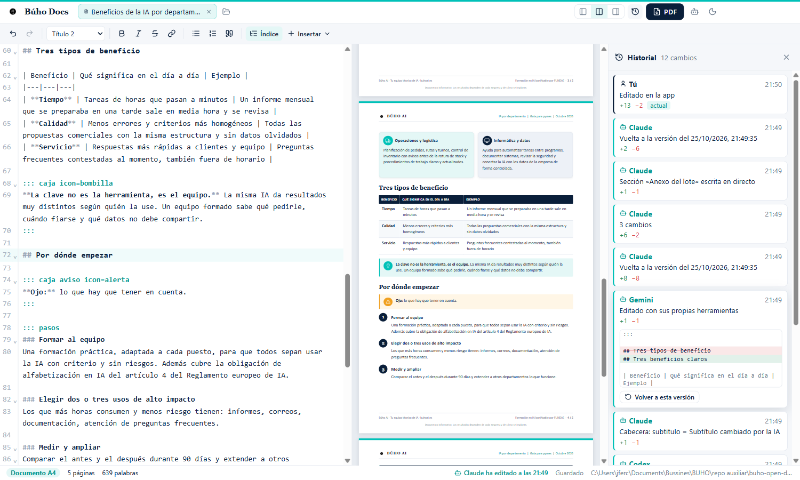
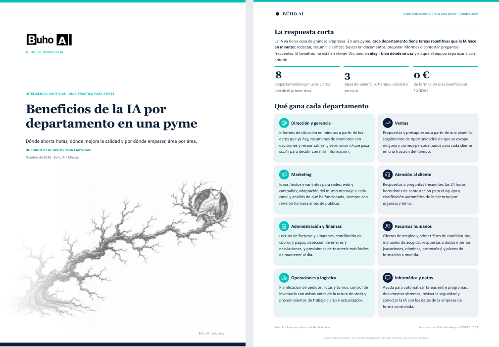

# Búho Docs · open docs, agentic first

Documentos **A4** y presentaciones **16:9** en PDF. **Tú escribes directamente sobre la página, como en Word** (negrita, títulos, listas, bloques); la IA escribe y cambia secciones o diapositivas por comandos, incluso **varias IAs a la vez**; **los dos veis cada cambio en directo** y todo queda en un historial firmado. Con el estilo Búho AI o en blanco, sin marca. De Buho Corps Systems.



## Por qué

Hacer un PDF bonito con una IA suele ser: pedirlo, esperar a que genere un script, ejecutarlo, abrir el PDF, ver la errata, volver a pedirlo… Búho Docs lo convierte en un documento vivo:

- **Markdown con cabecera YAML** como fuente: la IA lo escribe de maravilla y tú lo entiendes.
- **Vista previa = PDF**: la misma página que ves es la que imprime Chromium (A4 con paginador propio: 20 páginas en ~40 ms; diapositivas de 13,33 × 7,5 pulgadas, como los decks de PowerPoint).
- **PDF en caliente**: tras cada cambio la app prepara el PDF en segundo plano; `export` solo lo escribe (~0,1 s).
- **Cambios de la IA en directo**: el editor y la vista se actualizan solos y resaltan lo que ha cambiado, sin perder tu cursor ni tu deshacer.
- **Cambios pequeños**: la IA reescribe una sección, una diapositiva o una cifra (`section`, `slide`, `replace`, `meta`) en vez de regenerarlo todo.
- **Historial** por documento: quién cambió qué (tú, Claude, Codex, otro programa), con las diferencias y vuelta a cualquier versión.
- **Escribir como en Word**: el texto se edita sobre la propia página, con barra de formato (estilo de párrafo, negrita, cursiva, tachado, enlace, listas, cita), Intro y Retroceso como siempre, deshacer y corrector ortográfico. El Markdown queda debajo, por si lo quieres ver.
- **Generación en paralelo**: `buho-docs generar` reparte un plan entre varios modelos que escriben a la vez, en directo, cada uno en su sección o diapositiva (12 secciones en ~25 s).
- **Bloques prediseñados, índice y huecos**: cajas, tarjetas, tablas, pasos… de un clic; índice automático con números de página; huecos que se rellenan cuando llega una imagen o un texto de otro agente.
- **Temas como paquetes**: colores, letras, logo, marca y portada (`tema: buho|blanco|corporativo|calido|moderno` o uno propio, creado desde la app en un minuto o con `buho-docs tema crear`), más `css:` para retoques.
- **Plantillas genéricas**: acta, factura, presupuesto, propuesta, informe, carta, guía, one-pager, plan de proyecto, currículum, y presentaciones de pitch, formación y resultados; las tuyas, como .md en la carpeta de datos.
- **CLI instantáneo**: con la app abierta, `buho-docs` es un ejecutable nativo de 10 KB que le pasa el comando a la app (que lo ejecuta por dentro y atiende muchos a la vez): ~45 ms por comando.
- **De una frase a un documento**: `buho-docs generar informe.md "guía de ciberseguridad para una pyme" --paginas 8`: un modelo hace el índice y varios escriben las secciones a la vez (~40 s).
- **Importar**: Word (.docx), PDF, HTML y texto a Búho Docs (`buho-docs importar` o Abrir en la app). Word sale al momento con títulos, tablas e imágenes; los PDF se maquetan con IA en paralelo.
- **Exportar a Word** (.docx editable: estilos de título, listas, tablas, cajas, tarjetas, índice, portada, cabecera y pie con páginas), además de PDF. Botón «Word» o `buho-docs export doc.md --word`.
- **Revisión como con un compañero**: haz clic derecho sobre la página → *Comentar aquí…* (o activa *Comentar* y ve haciendo clic; también vale seleccionar un trozo) y escribe «quita esto», «mete algo así»… Al pulsar **Enviar a la IA**, un agente por cada parte comentada trabaja a la vez y te llegan **propuestas** en el panel de la derecha para aceptar o rechazar (una a una o todas). Con el *modo revisión*, cualquier cambio de un agente llega así. Para agentes: `--proponer`, `comentarios`, `atender`, `aceptar`.
- **Gráficos desde tablas**: `::: grafico barras|columnas|lineas|area|tarta|donut` con una tabla dentro; en Word y PowerPoint, gráficos nativos editables.
- **PowerPoint**: las presentaciones se exportan a .pptx editable (botón «PowerPoint» o `--pptx`). Al exportar (PDF, Word o PowerPoint) eliges dónde.
- **Abrir sin guardar**: «Nuevo», las plantillas y abrir un Word o un PDF crean un borrador al momento, sin elegir dónde; Ctrl+S lo guarda donde quieras. Al cerrar una pestaña o salir con algo sin guardar, se pregunta; los borradores se recuperan al volver a abrir. Guardado automático activable en la barra de estado. Para agentes: `buho-docs nuevo` y `buho-docs guardar`.
- **Por páginas**: `paginas` (qué hay en cada una) y `pagina N [--captura]` (su texto tal como sale, y la imagen).
- **Lectura rápida para IAs**: `mapa` (secciones con tokens), `leer` (texto limpio con límite de tokens), `buscar` (determinista: palabras, frase exacta y erratas, en milisegundos, en un documento o una carpeta) e **ids por bloque** para cambiar un párrafo exacto con `editar #b…`.

## Plantilla Búho

Navy `#0A1F3A` + turquesa `#00C1B8`, Georgia en títulos, Calibri en el texto.

| Documento A4 | Presentación 16:9 |
|---|---|
|  |  |

- **Documento**: portada con logo, etiqueta, título y el árbol con el búho; cabecera y pie en cada página; tablas con cabecera navy.
- **Presentación**: diseños `portada`, `normal`, `seccion`, `cita`, `cierre`, `dos-columnas`, `cifras`, `imagen`; aviso en rojo si una diapositiva no cabe.
- **Bloques** para los dos: `::: caja`, `::: tarjetas` (con iconos), `::: cifras`, `::: pasos`, `::: columnas`, `::: panel`, `::: nota`, `::: cita`, `::: indice`, `::: hueco`. Iconos de [Lucide](https://lucide.dev) con alias en español (`{icon=cohete}`).
- **En blanco**: `estilo: blanco` quita la marca (sin portada salvo `portada: true`, títulos negros, solo el número de página).

Ejemplos: [`examples/beneficios-ia-pymes.md`](examples/beneficios-ia-pymes.md) (documento) y [`examples/beneficios-ia-pymes-slides.md`](examples/beneficios-ia-pymes-slides.md) (presentación), con sus PDF al lado.

```markdown
---
tipo: documento
titulo: "Beneficios de la IA por departamento en una pyme"
etiqueta: "INTELIGENCIA ARTIFICIAL · GUÍA PRÁCTICA PARA PYMES"
fecha: "Octubre de 2026"
---

## La respuesta corta

::: tarjetas 2
### Ventas {icon=ventas}
Propuestas y presupuestos a partir de una plantilla.

### Marketing {icon=megafono}
Textos y variantes para cada canal.
:::
```

## Agentic first

```bash
buho-docs new "Informe.md" --kind documento --title "Informe trimestral"
buho-docs outline "Informe.md"                         # títulos y diapositivas con su línea
buho-docs section "Informe.md" "Ventas" --file ventas.md --author Claude
buho-docs slide "Deck.md" 3 --file diapo.md --author Claude
buho-docs replace "Informe.md" "erata" "errata" --author Claude
buho-docs check "Deck.md"                              # diapositivas que no caben, iconos, imágenes
buho-docs export "Informe.md"                          # PDF junto al .md
buho-docs history "Informe.md"
buho-docs batch "Informe.md" --file cambios.json        # varios cambios de una vez
buho-docs snapshot "Informe.md" --page 3              # PNG de una página
claude -p "…" --output-format stream-json --include-partial-messages --verbose | buho-docs stream "Informe.md" --section "Ventas" --claude
buho-docs generar "Guia.md" --plan plan.json --paralelo 12   # varias IAs a la vez, en directo
buho-docs insertar "Informe.md" tarjetas --despues "Ventas"   # bloque ya maquetado
buho-docs rellenar "Informe.md" grafico --imagen ventas.png    # rellena un hueco cuando llega
buho-docs indice "Informe.md"                                  # índice con números de página
buho-docs skill                                        # la guía completa para agentes
```

- El CLI va **dentro del instalador** (`<instalación>\cli`, añadido al PATH del usuario) y usa el propio ejecutable de la app en modo Node: no hace falta instalar Node. Si la app está cerrada, la abre.
- La guía [`skills/buho-docs/SKILL.md`](skills/buho-docs/SKILL.md) va con el programa y la app la deja en las skills de Claude Code, Codex y GitHub Copilot si están instalados: cualquier sesión nueva sabe usar Búho Docs sin que se lo digas.
- Si la IA prefiere editar el `.md` con sus propias herramientas, la app lo detecta en directo; con `buho-docs tag <doc> --author Claude` antes, queda firmado en el historial.
- API local en `127.0.0.1:47341` con token (`%APPDATA%\BuhoDocs\api.json`); rutas en [`src/main/api.ts`](src/main/api.ts).

## Velocidad

`node bench/velocidad.mjs` compara Búho Docs con la forma de siempre (un script de Python con reportlab) sobre el mismo Markdown de 20 páginas y los mismos 5 arreglos. Resultados en [`bench/resultados.md`](bench/resultados.md): cada arreglo se ve en directo en ~0,1 s y, con el tiempo normal que tarda un agente entre comandos, el PDF sale en ~0,1 s porque ya está hecho. La cuenta completa, contando lo que tarda el agente en escribir y comprobar, está en [`bench/ventana-total.md`](bench/ventana-total.md): crear un 35 % más rápido y corregir unas 6 veces más rápido.

## Instalar o usar portable

`npm run dist` genera en `dist/`:

- **Instalador** `Buho-Docs-<v>-x64.exe` (por usuario, sin administrador): app en `%LOCALAPPDATA%\Programs\BuhoDocs`, CLI en el PATH, «Abrir con Búho Docs» en el clic derecho de los `.md`. Al desinstalar quita todo.
- **Portable** `Buho-Docs-<v>-portable.zip`: se descomprime donde quieras; `portable.txt` hace que los datos vayan a la carpeta `datos` de al lado.

Sin firma de código por ahora (ver [docs/firma-de-codigo.md](docs/firma-de-codigo.md)).

## Desarrollo

```bash
npm install
npm run dev
npm run typecheck
npm run test:e2e   # app aislada: CLI, cambios en directo, autoguardado, historial, diapositivas, PDF
npm run dist
```

Stack: Electron 44 + electron-vite + React 19 + TypeScript, CodeMirror 6, markdown-it, Lucide; paginador A4 propio (`src/renderer/src/preview/paginate.ts`). `BUHO_DATA_DIR` aísla los datos; `BUHO_API_PORT` cambia el puerto.

## Licencia

Código: [MIT](LICENSE). El logotipo, el árbol con el búho y la marca Búho AI (`src/renderer/src/brand/`) son de Buho Corps Systems y no entran en la licencia MIT: para tu propia marca, sustituye esa carpeta.
