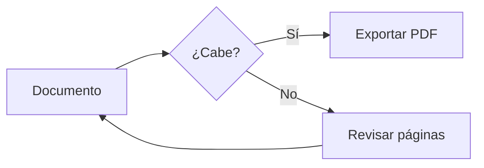
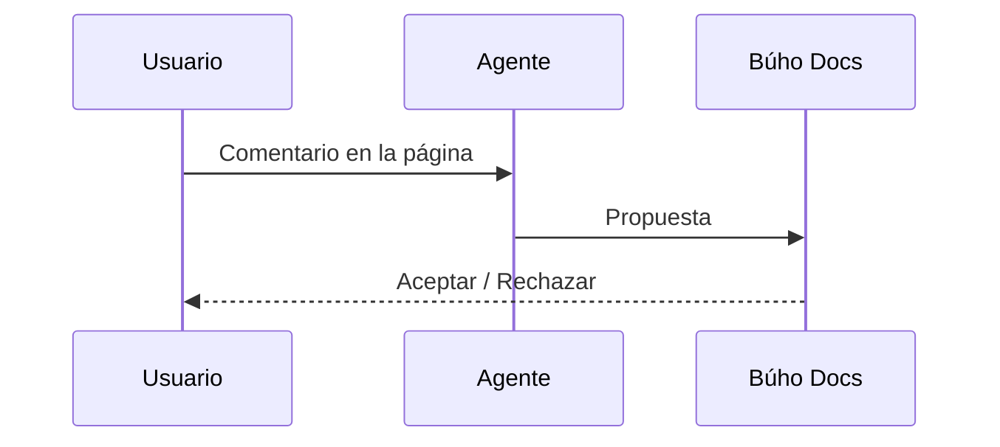

## Fórmulas

El coste por consulta es $C = \frac{t_{in} \cdot p_{in} + t_{out} \cdot p_{out}}{10^6}$ y el ahorro anual:

$$
A = 12 \sum_{i=1}^{n} h_i \cdot c_i \cdot \eta
$$

## Código

```python titulo="buscar.py"
def buscar(indice, consulta, k=5):
    """Devuelve los k fragmentos más parecidos."""
    v = embed(consulta)
    return sorted(indice, key=lambda f: -coseno(v, f.vector))[:k]
```

```ts
const r = await fetch(`${API}/v1/buscar`, { method: 'POST', body: JSON.stringify({ q }) })
```

## Diagrama





## SVG

```svg
<svg viewBox="0 0 400 120" xmlns="http://www.w3.org/2000/svg">
  <rect x="10" y="20" width="110" height="80" rx="10" fill="#e8f8f7" stroke="#00c1b8" stroke-width="2"/>
  <text x="65" y="65" text-anchor="middle" font-size="16" fill="#0a1f3a">Entrada</text>
  <path d="M125 60 H 270" stroke="#0a1f3a" stroke-width="2" marker-end="url(#f)"/>
  <defs><marker id="f" viewBox="0 0 10 10" refX="9" refY="5" markerWidth="8" markerHeight="8" orient="auto"><path d="M0 0 L10 5 L0 10z" fill="#0a1f3a"/></marker></defs>
  <rect x="275" y="20" width="110" height="80" rx="10" fill="#0a1f3a"/>
  <text x="330" y="65" text-anchor="middle" font-size="16" fill="#fff">Salida</text>
  <script>alert(1)</script>
</svg>
```
